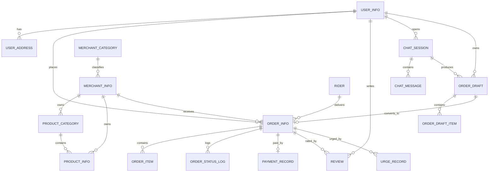

# 系统设计说明书

**项目名称：** 基于 Python 的外卖平台的管理与实现

> 说明：本文档为草稿，章节与图表可按学校论文模板调整。

---

## 一、总体设计

### 1.1 设计目标

设计一个结构清晰、易于实现与维护的多商户外卖平台，后端与前端分离，按业务模块组织代码；将"平台业务"与"AI 辅助服务"分开，AI 仅作为业务的一种"输入方式"，不改变业务的安全边界。

### 1.2 系统架构

系统采用**前后端分离**架构：后端为 Django 提供的 JSON 接口，前端为三个独立构建的单页应用，运营端由 Django Admin 承载。

```
┌───────────────────────────────────────────────────────────┐
│  表现层                                                     │
│  顾客端 SPA │ 商户端 SPA │ 骑手端 SPA │ 运营端(Django Admin)  │
│  Vue 3 + Vite + TypeScript，三端各自独立构建                 │
├───────────────────────────────────────────────────────────┤
│  接口层（Django 视图）                                       │
│  路由分发 · 参数校验 · 令牌认证 · 作用域过滤 · 统一响应格式     │
│  ── AI 工具接口（ai_service.tools）──                        │
├───────────────────────────────────────────────────────────┤
│  数据层（Django ORM / Models）                               │
│  SQLite（默认）/ MySQL 8（可切换）                            │
└───────────────────────────────────────────────────────────┘
```

设计要点：

- **前后端分离**：后端只提供 JSON 接口，不渲染业务页面；前端三端各自独立构建与部署。运营端不单独开发前端界面，直接由 Django Admin 承载。
- **分层取舍**：本期不设独立服务层（Services），视图函数直接使用 ORM，以减少抽象层数，便于在教学规模下把逻辑读通。代价是令牌认证与作用域过滤需要在每个视图上显式声明，因此约定两条硬性规则：认证统一使用 `common/auth.py` 中的装饰器；凡涉及资源的查询与写操作，查询条件必须带上作用域字段（`user` / `merchant` / `rider`）。
- **AI 与业务解耦**：AI 服务只调用工具接口，不直接操作数据库；工具接口与人工请求共用同一套校验与审计。
- **安全边界统一**：无论请求来自前端页面还是 AI，都经过同一套认证、权限与作用域校验，AI 不享有特权通道。

### 1.3 技术选型

| 层次 | 技术 | 说明 |
| --- | --- | --- |
| 语言 | Python 3.x | 与课题一致 |
| Web 框架 | Django | 提供 ORM、数据库迁移、认证与权限、Admin；视图层采用手写函数视图 + 统一响应封装 |
| 数据库 | SQLite（默认）/ MySQL 8（可切换） | 设置 `DB_ENGINE=mysql` 切换至 MySQL 8 |
| 前端框架 | Vue 3 + Vite + TypeScript | 顾客端、商户端、骑手端三个单页应用 |
| 前端工程化 | npm workspaces 单仓库多应用 | `apps/customer`、`apps/merchant`、`apps/rider` + 共享包 `packages/shared` |
| 前端组件与图表 | Vant 4（顾客端与骑手端）、Element Plus + ECharts（商户端） | 移动端组件库与后台组件库分别选型 |
| 前端状态与路由 | Pinia + Vue Router | 状态管理与路由 |
| 接口通信 | REST 风格 JSON | 统一响应格式 `{code, info, data}`，成功 code 为 `00000` |
| 认证 | 自签名令牌（Django signing） | 四类角色各自使用独立盐值 |
| 管理后台 | Django Admin | 平台运营端 |
| AI | 大语言模型 Function Calling（OpenAI 兼容接口） | 未配置模型凭据时走内置规则化兜底实现 |

### 1.4 模块划分

**后端（Django 应用）**

| 模块 | 职责 |
| --- | --- |
| `user` | 顾客登录、资料、收货地址 |
| `merchant` | 商户入驻与信息、商户分类、顾客端商户浏览接口 |
| `product` | 菜品与菜品分类、上下架与可售数量 |
| `cart` | 购物车（本期由顾客端本地维护，后端不持久化，仅保留应用目录与迁移历史） |
| `order` | 下单、订单查询、状态流转与状态日志、催单记录 |
| `payment` | 模拟支付与支付记录 |
| `delivery` | 骑手登录、接单、送达、任务查询 |
| `review` | 订单评价 |
| `platform_ops` | 商户审核、全局查询与统计、操作日志、站内信 |
| `ai_service` | AI 会话、槽位收集、工具调用、订单草稿 |
| `common` | 统一响应、令牌认证、路由分发、公共模型、种子数据 |
| `config` | 项目配置与总路由 |

**前端（单仓库多应用）**

| 应用 | 职责 |
| --- | --- |
| `apps/customer` | 顾客端：浏览、购物车、下单、支付、订单、地址、评价、AI 点餐助手 |
| `apps/merchant` | 商户端：注册与入驻、登录、分类与菜品管理、订单处理、营业信息与统计 |
| `apps/rider` | 骑手端：登录、待接单列表、接单、送达、本人任务 |
| `packages/shared` | 三端共用的请求封装、本地存储封装与格式化工具 |

---

## 二、关键流程设计

### 2.1 下单流程

```
顾客浏览 → 加入购物车(顾客端本地) → 结算(选地址/备注) → 提交订单(待支付)
        → 模拟支付(已支付) → 商户接单(待接单)
        → 骑手接单(配送中) → 骑手送达(已完成) → 可评价
```

订单金额由服务端重算：`pay_amount = total_amount + delivery_fee`，其中 `delivery_fee` 为平台统一固定值（本期 2 元），在下单时快照进订单。

### 2.2 AI 辅助下单流程（核心）

```
顾客在顾客端打开 AI 点餐助手 → 以当前登录顾客身份创建会话
   │
   ├─ AI 调用 search_merchant        定位商户
   ├─ AI 调用 search_menu            定位菜品
   ├─ AI 调用 validate_draft         后端重校验(价格/库存/归属)
   └─ AI 调用 create_draft           生成草稿单
   │
草稿展示给顾客 → 顾客确认 → 草稿转正式订单 → 模拟支付
   │
所有工具调用与草稿创建/确认 → 写入 operation_log
```

关键约束：`create_draft` **只生成草稿**，不生成正式订单；正式订单必须由顾客确认后由服务端创建。AI 点餐助手是顾客端内的功能，其操作主体与作用域均归属当前登录顾客。

### 2.3 订单状态机

```
[待支付] ──顾客支付──▶ [已支付] ──商户接单──▶ [待接单] ──骑手接单──▶ [配送中] ──骑手送达──▶ [已完成] ──▶ 顾客可评价
   │                      │  │                  │  │
   │顾客取消               │  │顾客申请退款       │  │顾客申请退款
   ▼                      ▼  ▼                  ▼  ▼
[已取消] ◀──商户取消──   [退款中] ◀───────────────┘
                            │ 商户审核：同意
                            ▼
                         [已退款]      （拒绝则退回申请前状态：已支付/待接单）
```

商户取消：处于可取消状态的订单可由商户取消，进入 [已取消]。

退款：顾客对「已支付/待接单」订单申请退款进入 [退款中]（全额，留存退款记录）；商户审核同意进入 [已退款]（模拟到账，支付记录同步标记已退款），拒绝退回申请前状态。退款审核中的订单不接受取消/接单等其他状态操作。

状态枚举：

| 值 | 状态 |
| --- | --- |
| 10 | 待支付 |
| 20 | 已支付 |
| 30 | 待接单 |
| 40 | 配送中 |
| 50 | 已完成 |
| 60 | 已取消 |

> 说明：70（退款中）、80（已退款）随退款功能启用；退款审核中的订单只能通过审核离开该状态。本期不设"已接单未配送""取餐中"等中间态，骑手接单即进入配送中。

各端状态呈现口径：

订单状态在后端以**整数枚举**表示（10–60），该整数是唯一真值。顾客端接口与商户端接口**直接返回该整数**，不再各自做一次映射；状态文案由前端按自身视角呈现，映射表集中放在三端共享包 `packages/shared` 中，各端在必要时可覆盖个别措辞。

| 后端状态 | 顾客端呈现 | 商户端呈现 |
| --- | --- | --- |
| 10 | 待支付 | 待支付 |
| 20 | 已支付 | 已支付 |
| 30 | 待接单 | 已接单，待骑手取餐 |
| 40 | 配送中 | 配送中 |
| 50 | 已完成 | 已完成 |
| 60 | 已取消 | 已取消 |

> 设计理由：状态 30 是商户执行"接单"动作之后才出现的，向商户呈现"待接单"会与其自身动作相矛盾，因此文案允许按各端视角不同，但状态的取值只有一套。
>
> 说明：骑手端的任务状态（待抢单 / 已接单 / 配送中 / 已完成）是由订单状态与是否已分配骑手**派生的视图状态**，属于呈现层计算，不是订单状态本身。

每次实际状态变更均写入 `order_status_log`（记录原状态、新状态、操作者角色与时间）。

### 2.4 骑手配送流程（轻量）

```
骑手查看[待接单]列表 → 点击接单(订单归属本人并进入[配送中])
                    → 点击送达(订单→[已完成], 记录送达时间)
```

派单方式：骑手自行抢占（先到先得），不做算法派单。不提供拒单与退单路径。

### 2.5 商户入驻与审核流程

```
商户端注册(账号/密码/店名/电话/地址/简介) → 生成商户记录, 状态=待审核
   │
   ├─ 商户可登录，但仅能查看入驻审核状态
   │
运营在 Django Admin 查看申请 → 通过(20) / 驳回(30)
   │
   └─ 通过后，该商户方可使用菜品管理与订单处理功能
```

---

## 三、数据库设计

### 3.1 设计原则

- 以业务主线（多商户下单 + AI 草稿 + 订单流转 + 轻量配送）为中心，仅保留必要表；
- 金额、价格使用 `Decimal`，避免浮点误差；
- 订单与明细对菜品名称与单价做**快照**，避免菜品后续变更影响历史订单；
- 认证与角色统一使用 Django 内置 `auth_user`，各角色的业务档案通过一对一字段关联；
- 使用外键维护实体关系，关键字段建立索引。

### 3.2 E-R 关系（概要）



### 3.3 表结构设计

> 说明：登录与角色统一使用 Django 内置 `auth_user`；下表中"主键"均为自增整型 `id`；所有业务表统一带 `create_time` 与 `update_time` 两个时间字段（`operation_log` 只带 `create_time`）。

#### （1）用户域

**user_info（顾客资料）**

| 字段 | 类型 | 说明 |
| --- | --- | --- |
| id | int | 主键 |
| auth_user_id | int | 关联登录账号（唯一） |
| nickname | varchar(50) | 昵称 |
| phone | varchar(20) | 手机号（唯一） |
| gender | tinyint | 性别：0 未知 / 1 男 / 2 女 |
| avatar | varchar(255) | 头像地址 |

**user_address（收货地址）**

| 字段 | 类型 | 说明 |
| --- | --- | --- |
| id | int | 主键 |
| user_id | int | 顾客 |
| receiver | varchar(50) | 收货人 |
| phone | varchar(20) | 联系电话 |
| province / city / district | varchar(50) | 省 / 市 / 区 |
| detail | varchar(200) | 详细地址 |
| is_default | bool | 是否默认地址 |

#### （2）商户域

**merchant_category（商户分类）**：id、name、sort

**merchant_info（商户）**

| 字段 | 类型 | 说明 |
| --- | --- | --- |
| id | int | 主键 |
| auth_user_id | int | 关联登录账号（唯一） |
| name | varchar(100) | 商户名称 |
| category_id | int | 商户分类（可空） |
| logo | varchar(255) | 门店图片 |
| phone | varchar(20) | 联系电话 |
| address | varchar(200) | 商户地址 |
| description | varchar(255) | 店铺简介 |
| status | tinyint | 10 待审核 / 20 已通过 / 30 已驳回 |
| is_open | bool | 营业中标记 |
| open_time / close_time | time | 营业时间（可空；本期不参与下单拦截） |

#### （3）商品域

**product_category（菜品分类）**：id、merchant_id、name、sort

**product_info（菜品）**

| 字段 | 类型 | 说明 |
| --- | --- | --- |
| id | int | 主键 |
| merchant_id | int | 所属商户 |
| category_id | int | 分类 |
| name | varchar(100) | 菜品名称 |
| image | varchar(255) | 图片 |
| description | varchar(255) | 描述 |
| price | decimal(10,2) | 价格 |
| stock | int | 可售数量 |
| status | tinyint | 10 上架 / 20 下架 |

> 本期菜品不含规格维度，因此不设 `product_spec` 与 `product_sku`；菜品的可交易属性为价格与可售数量。

#### （4）订单域

**order_info（订单主表）**

| 字段 | 类型 | 说明 |
| --- | --- | --- |
| id | int | 主键 |
| order_no | varchar(32) | 订单号（唯一） |
| user_id | int | 顾客 |
| merchant_id | int | 商户（一单仅属一个商户） |
| address_snapshot | varchar(300) | 收货地址快照 |
| total_amount | decimal(10,2) | 商品金额合计 |
| delivery_fee | decimal(10,2) | 配送费（平台统一固定值，本期 2 元，下单时快照） |
| pay_amount | decimal(10,2) | 实付金额（＝商品金额 + 配送费） |
| status | tinyint | 订单状态（见 2.3 状态枚举） |
| rider_id | int | 骑手（可空） |
| remark | varchar(255) | 备注 |
| pay_time | datetime | 支付时间 |
| deliver_time | datetime | 送达时间 |
| finish_time | datetime | 完成时间 |

**order_item（订单明细，含快照）**：id、order_id、product_id、product_name、price、quantity、amount

**order_status_log（订单状态变更日志）**：id、order_id、from_status、to_status、operator_id、operator_role、create_time

**urge_record（催单记录）**：id、order_id、operator_id、operator_role（customer / ai）、content、create_time

#### （5）支付域

**payment_record（支付记录）**：id、order_id、amount、method（模拟）、status（10 待支付 / 20 支付成功 / 30 支付失败）、pay_time

> 退款记录（`refund_record`）随退款功能启用：订单、退款金额、申请原因、审核状态、申请时订单状态、审核备注与审核时间。

#### （6）配送域（轻量）

**rider（骑手）**：id、auth_user_id（唯一）、name、phone、status（0 空闲 / 1 忙碌）

> 配送信息直接挂在 `order_info` 上（`rider_id`、`deliver_time`、`status`）；如后续需要多段配送再单独拆 `delivery_task` 表。骑手账号由平台运营在管理后台创建。

#### （7）评价域

**review（评价）**

| 字段 | 类型 | 说明 |
| --- | --- | --- |
| id | int | 主键 |
| order_id | int | 订单 |
| user_id | int | 评价人 |
| merchant_id | int | 被评商户 |
| product_id | int | 被评菜品（可空） |
| target_type | tinyint | 评价对象：10 菜品 / 20 商户 |
| rating | tinyint | 评分 1–5 |
| content | varchar(255) | 留言 |

> 一单一评；商户端展示的商户评分为该商户名下所有评价的评分均值。

#### （8）平台运营与审计

**operation_log（操作日志 / 审计）**

| 字段 | 类型 | 说明 |
| --- | --- | --- |
| id | int | 主键 |
| actor_id | int | 操作者 ID |
| actor_role | varchar(20) | 操作者角色（含 ai） |
| action | varchar(50) | 动作（如 create_draft） |
| target_type | varchar(50) | 目标类型 |
| target_id | int | 目标 ID |
| detail | text | 参数与前后状态 |
| result | varchar(20) | 结果（success / fail） |
| ip | varchar(50) | 来源 IP |
| create_time | datetime | 时间 |

**notification（站内信）**：id、to_user_id、title、content、type（10 催单 / 20 系统）、is_read、create_time

#### （9）AI 服务域（创新点）

**chat_session（会话）**：id、customer_id、status（10 进行中 / 20 已结束）

**chat_message（消息）**：id、session_id、role（user / assistant / system / tool）、content、tool_name

**order_draft（订单草稿）**

| 字段 | 类型 | 说明 |
| --- | --- | --- |
| id | int | 主键 |
| session_id | int | 所属会话（可空） |
| customer_id | int | 顾客 |
| merchant_id | int | 商户 |
| address_id | int | 收货地址（可空） |
| total_amount | decimal(10,2) | 后端重校验后的金额 |
| status | tinyint | 10 待确认 / 20 已确认 / 30 已作废 |
| order_id | int | 确认后生成的正式订单（可空） |
| confirm_time | datetime | 确认时间 |

**order_draft_item（草稿明细）**：id、draft_id、product_id、quantity、price_snapshot

#### （10）遗留表清理

首期实施不涉及退款与菜品规格的完整流程，购物车由顾客端本地维护，系统参数不做配置化，因此模型层清理了以下表：`shopping_cart`（购物车）、`refund_record`（退款记录）、`product_spec` 与 `product_sku`（规格与 SKU）、`system_config`（系统配置）。相应地，`order_item` 与 `order_draft_item` 不再包含 `sku` 与 `spec_text` 字段。其中退款功能已实现（见 `02-需求分析.md` F-A-11 第 5 稿）：`refund_record` 表已重新引入（订单、退款金额、申请原因、审核状态、申请时订单状态等字段），订单状态取值 70（退款中）/ 80（已退款）已启用。

### 3.4 索引与约束

- 唯一约束：`order_no`、`user_info.phone`，以及各角色档案与 `auth_user` 的一对一关系；
- 普通索引：`order_info(user, status)`、`order_info(merchant, status)`、`operation_log(actor_id, create_time)`；
- 外键约束：订单明细、评价、草稿明细、状态日志等均引用主表。

---

## 四、AI 工具接口设计

AI 通过以下工具（Function Calling）与业务交互，**均不涉及正式订单的写入与资金操作**：

| 工具 | 入参 | 出参 | 说明 |
| --- | --- | --- | --- |
| search_merchant | keyword | 商户列表 | 按名称搜索已通过审核的商户 |
| search_menu | merchant_id, keyword | 菜品列表 | 搜索某商户的在售菜品 |
| validate_draft | merchant_id, items | 校验结果 | 后端重校验价格 / 库存 / 商户归属 |
| create_draft | merchant_id, items, address_id | 草稿摘要 | 生成**草稿**（非正式订单） |
| get_order_status | order_id | 状态与骑手 | 查询订单进度；未指定时取该顾客最近一笔订单 |
| urge_order | order_id, content | 催单结果 | 生成催单记录并向商户/骑手写入站内信 |
| submit_review | order_id, rating, content | 评价结果 | 对已完成订单提交评价（与人工评价同口径：一单一评、评分钳制 1–5） |
| get_my_history | — | 口味画像 | 常点商户、常点菜品、客单价、常点时段 |
| recommend_dishes | limit | 推荐列表 | 基于历史偏好推荐菜品，每条带推荐理由 |

交互原则：模型只负责"理解与组织参数"，所有校验与写入由后端完成；每次调用记录审计日志。

个性化推荐与一键复购是工具之外的直连接口：`GET /api/v1/ai/recommend` 输出口味画像
与「猜你想吃」推荐；`POST /api/v1/ai/reorder` 用最近一笔有效订单重建待确认草稿，
自动跳过下架/缺货菜品。顾客确认草稿后由前端串联支付接口完成「确认即支付」，
不经购物车与结算页。

---

## 五、安全设计

| 方面 | 措施 |
| --- | --- |
| 认证 | 自签名令牌（Django signing），四类角色各自独立盐值 |
| 授权 | RBAC，按角色授权；平台运营额外要求运营账号标识（`is_staff`）；未通过审核的商户不得使用菜品管理与订单处理功能 |
| 数据隔离 | 以 `user_id` / `merchant_id` / `rider_id` 做作用域过滤，防跨商户、跨顾客越权 |
| 状态安全 | 订单状态迁移校验，拒绝非法迁移 |
| AI 安全 | AI 无写库权限；AI 工具接口与业务接口共用同一套认证与作用域校验；草稿需后端重校验 + 顾客确认 |
| 审计 | `operation_log` 记录关键操作（含 AI 工具调用） |

---

## 六、部署与运行

- **后端**：`takeout\run.bat`，或 `python manage.py runserver 8091`；
- **前端开发态**：在 `web/` 下执行 `npm run dev`，三个应用分别运行在 5173（顾客）、5174（商户）、5175（骑手），Vite 将 `/api`、`/media` 代理到 8091；
- **前端生产态**：在 `web/` 下执行 `npm run build`，产出各应用的 `dist`，由 Django **同源托管**（顾客端根路径、商户端 `/merchant/`、骑手端 `/rider/`）；
- **数据库**：默认 SQLite（零配置）；设置 `DB_ENGINE=mysql` 切换至 MySQL 8；
- **初始化**：`python manage.py migrate` 建表，`python manage.py seed_demo` 造演示数据。

---

## 七、待确认事项

- [ ] AI 所使用的大语言模型与调用方式。
