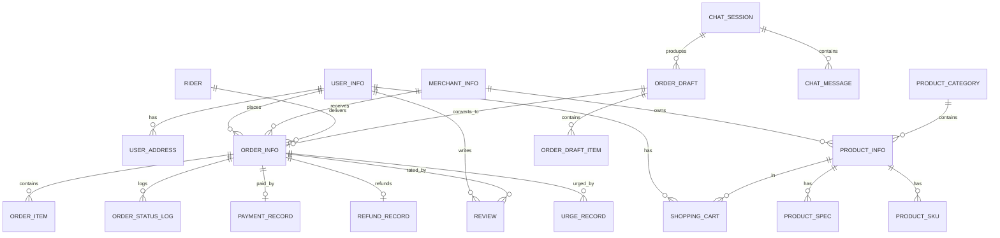

# 系统设计说明书

**项目名称：** 基于 Python 的外卖平台的管理与实现

> 说明：本文档为草稿，章节与图表可按学校论文模板调整。

---

## 一、总体设计

### 1.1 设计目标

设计一个结构清晰、易于实现与维护的多商户外卖平台，采用模块化设计，分离"平台业务"与"AI 辅助服务"两块；AI 仅作为业务的一种"输入方式"，不改变业务的安全边界。

### 1.2 系统架构

系统采用 **Django 的 MVT（Model–View–Template）架构**，逻辑上分为三层：

```
┌─────────────────────────────────────────────┐
│  表现层（前端）                                │
│  顾客 H5 | 商户后台 | 骑手页 | 运营后台         │
├─────────────────────────────────────────────┤
│  接口层（Views / API）                         │
│  参数校验 · 身份认证 · 权限校验 · 路由          │
├─────────────────────────────────────────────┤
│  业务层（Services）                            │
│  用户 · 商户 · 商品 · 购物车 · 订单 · 支付      │
│  · 配送 · 退款 · 评价 · 催单 · 审计            │
│  ── AI 服务（工具调用 + 会话 + 草稿）──         │
├─────────────────────────────────────────────┤
│  数据层（Models / ORM）                        │
│  SQLite / MySQL                               │
└─────────────────────────────────────────────┘
```

设计要点：

- **分层但不复杂**：表现层、接口层、业务层、数据层，按业务模块组织代码，不引入领域驱动设计等重型模式。
- **AI 与业务解耦**：AI 服务只调用业务层暴露的"工具接口"，绝不直接操作数据库。
- **安全边界统一**：无论请求来自人工页面还是 AI，都走同一套认证、权限与校验。

### 1.3 技术选型

| 层次 | 技术 | 说明 |
| --- | --- | --- |
| 语言 | Python 3.x | 与课题一致 |
| Web 框架 | Django | 自带 ORM、认证、权限、Admin |
| 数据库 | SQLite（可切换 MySQL） | 开发/演示用 SQLite，配置可切换 |
| 前端 | HTML/CSS/JS | 复用现有 H5 页面，后端按接口约定实现 |
| AI | 大语言模型 Function Calling | 通过工具调用参与业务 |
| 管理后台 | Django Admin | 平台运营与部分角色管理 |

### 1.4 模块划分

| 模块 | 职责 |
| --- | --- |
| 用户模块 | 注册登录、资料、收货地址 |
| 商户模块 | 入驻申请、商户信息、分类 |
| 商品模块 | 菜品、分类、规格（SKU）、上下架 |
| 购物车模块 | 加购、改量、删除 |
| 订单模块 | 下单、订单查询、状态流转 |
| 支付模块 | 模拟支付、支付记录 |
| 退款模块 | 退款申请与处理（简化） |
| 配送模块 | 骑手管理、接单、送达（轻量） |
| 评价模块 | 订单评价（菜品/商户） |
| 催单模块 | 催单记录与通知 |
| 平台运营模块 | 商户审核、全局管理、操作日志 |
| AI 服务模块 | 会话、槽位收集、工具调用、草稿单 |
| 审计模块 | 记录关键操作 |

---

## 二、关键流程设计

### 2.1 下单流程

```
顾客浏览 → 加入购物车 → 结算(选地址/备注) → 提交订单(待支付)
        → 模拟支付(已支付) → 商户接单/出餐(待接单)
        → 骑手接单(配送中) → 骑手送达(已完成) → 可评价
```

### 2.2 AI 辅助下单流程（核心）

```
客服建会话 → 顾客自然语言描述需求
   │
   ├─ AI 调用 search_merchant        定位商户
   ├─ AI 调用 search_menu            定位菜品
   ├─ AI 调用 get_item_specs         取规格与单价
   ├─ AI 调用 validate_draft         后端重校验(价格/库存/归属/地址)
   └─ AI 调用 create_draft           生成草稿单
   │
草稿展示给顾客 → 顾客确认 → 草稿转正式订单 → 模拟支付
   │
所有工具调用与草稿创建/确认 → 写入 operation_log
```

关键约束：`create_draft` **只生成草稿**，不生成正式订单；正式订单必须由顾客确认后由业务层创建。

### 2.3 订单状态机

```
[待支付] ──支付成功──▶ [已支付] ──商户出餐──▶ [待接单]
   │                                        │
   │取消                                     │骑手接单
   ▼                                        ▼
[已取消]                                  [配送中]
                                            │骑手送达
                                            ▼
                                        [已完成] ──▶ 可评价

[已支付/待接单/配送中] ──申请退款──▶ [退款中] ──退款成功──▶ [已退款]
```

状态枚举建议：

| 值 | 状态 |
| --- | --- |
| 10 | 待支付 |
| 20 | 已支付（待出餐） |
| 30 | 待接单（待骑手） |
| 40 | 配送中 |
| 50 | 已完成 |
| 60 | 已取消 |
| 70 | 退款中 |
| 80 | 已退款 |

每次变更均校验迁移合法性，并写入 `order_status_log`。

### 2.4 骑手配送流程（轻量）

```
骑手查看[待接单]列表 → 点击接单(订单→配送中, 记录 rider_id)
                    → 点击送达(订单→已完成, 记录送达时间)
```

派单方式：骑手自行抢占（先到先得），不做算法派单。

### 2.5 退款流程（简化）

```
顾客对[已支付~配送中]订单发起退款 → 商户/运营确认 → [退款中] → 模拟退款 → [已退款]
```

---

## 三、数据库设计

### 3.1 设计原则

- 以业务主线（多商户下单 + AI 草稿 + 订单流转 + 轻量配送）为中心，仅保留必要表；
- 金额、价格使用 `Decimal`，避免浮点误差；
- 订单与明细对商品名称/规格/单价做**快照**，避免商品后续变更影响历史订单；
- 使用外键维护实体关系，关键字段建立索引。

### 3.2 E-R 关系（概要）



### 3.3 表结构设计

> 说明：登录与角色统一使用 Django 内置 `auth_user`（通过扩展的 `user_info` / `merchant_info` 关联），下表中"主键"均为自增整型 `id`，时间字段统一为 `datetime`。

#### （1）用户域

**user_info（顾客资料）**

| 字段 | 类型 | 说明 |
| --- | --- | --- |
| id | int | 主键 |
| auth_user_id | int | 关联 Django 用户 |
| nickname | varchar(50) | 昵称 |
| phone | varchar(20) | 手机号 |
| gender | tinyint | 性别 |
| create_time | datetime | 创建时间 |

**user_address（收货地址）**

| 字段 | 类型 | 说明 |
| --- | --- | --- |
| id | int | 主键 |
| user_id | int | 顾客 |
| receiver | varchar(50) | 收货人 |
| phone | varchar(20) | 联系电话 |
| province/city/district | varchar(50) | 省/市/区 |
| detail | varchar(200) | 详细地址 |
| is_default | tinyint | 是否默认 |

#### （2）商户域

**merchant_info（商户）**

| 字段 | 类型 | 说明 |
| --- | --- | --- |
| id | int | 主键 |
| auth_user_id | int | 关联登录用户 |
| name | varchar(100) | 商户名称 |
| category_id | int | 商户分类 |
| logo | varchar(255) | 门店图片 |
| phone | varchar(20) | 联系电话 |
| address | varchar(200) | 商户地址 |
| status | tinyint | 10 待审核 / 20 通过 / 30 驳回 |
| open_time / close_time | time | 营业时间 |
| create_time | datetime | 入驻时间 |

**merchant_category（商户分类）**：id、name、sort

#### （3）商品域

**product_category（菜品分类）**：id、merchant_id、name、sort

**product_info（菜品）**

| 字段 | 类型 | 说明 |
| --- | --- | --- |
| id | int | 主键 |
| merchant_id | int | 所属商户 |
| category_id | int | 分类 |
| name | varchar(100) | 菜品名称 |
| image | varchar(255) | 图片 |
| description | varchar(255) | 描述 |
| price | decimal(10,2) | 价格 |
| stock | int | 库存 |
| status | tinyint | 10 上架 / 20 下架 |

**product_spec（规格项）**：id、product_id、name（如"辣度"）、options（可选值，如"微辣,中辣,特辣"）

**product_sku（规格组合/可售单元）**：id、product_id、spec_text（规格描述）、price、stock

#### （4）购物车

**shopping_cart（购物车）**：id、user_id、merchant_id、product_id、sku_id、quantity、create_time

#### （5）订单域

**order_info（订单主表）**

| 字段 | 类型 | 说明 |
| --- | --- | --- |
| id | int | 主键 |
| order_no | varchar(32) | 订单号（唯一） |
| user_id | int | 顾客 |
| merchant_id | int | 商户（一单仅属一个商户） |
| address_snapshot | varchar(300) | 收货地址快照 |
| total_amount | decimal(10,2) | 商品总额 |
| pay_amount | decimal(10,2) | 实付金额 |
| status | tinyint | 订单状态（见状态枚举） |
| rider_id | int | 骑手（可空） |
| remark | varchar(255) | 备注 |
| create_time | datetime | 下单时间 |
| pay_time | datetime | 支付时间 |
| deliver_time | datetime | 送达时间 |
| finish_time | datetime | 完成时间 |

**order_item（订单明细，含快照）**：id、order_id、product_id、sku_id、product_name、spec_text、price、quantity、amount

**order_status_log（订单状态变更日志）**：id、order_id、from_status、to_status、operator_id、operator_role、create_time

#### （6）支付域

**payment_record（支付记录）**：id、order_id、amount、method（模拟）、status、pay_time

**refund_record（退款记录）**：id、order_id、user_id、amount、reason、status（10 申请/20 已退款/30 驳回）、create_time、finish_time

#### （7）配送域（轻量）

**rider（骑手）**：id、auth_user_id、name、phone、status（0 空闲 / 1 忙碌）

> 说明：配送明细直接挂在 `order_info`（`rider_id`、`deliver_time`、`status`）上；如后续需要多段配送再单独拆 `delivery_task` 表。

#### （8）评价与催单

**review（评价）**

| 字段 | 类型 | 说明 |
| --- | --- | --- |
| id | int | 主键 |
| order_id | int | 订单 |
| user_id | int | 评价人 |
| merchant_id | int | 被评商户 |
| product_id | int | 被评菜品（可空） |
| rating | tinyint | 评分 1–5 |
| content | varchar(255) | 留言 |
| create_time | datetime | 评价时间 |

**urge_record（催单记录）**：id、order_id、operator_id、operator_role（顾客/客服）、content、create_time

**notification（站内信，可选）**：id、to_user_id、title、content、type（催单/系统）、is_read、create_time

#### （9）平台运营与审计

**operation_log（操作日志 / 审计）**

| 字段 | 类型 | 说明 |
| --- | --- | --- |
| id | int | 主键 |
| actor_id | int | 操作者 |
| actor_role | varchar(20) | 角色（含 AI） |
| action | varchar(50) | 动作（如 create_draft） |
| target_type | varchar(50) | 目标类型 |
| target_id | int | 目标 ID |
| detail | text | 前后状态/参数 |
| result | varchar(20) | 成功/失败 |
| create_time | datetime | 时间 |

**system_config（系统配置，可选）**：id、config_key、config_value、remark

#### （10）AI 服务域（新增，创新点）

**chat_session（会话）**：id、cs_user_id（客服）、customer_id、status（10 进行中 / 20 已结束）、create_time

**chat_message（消息）**：id、session_id、role（user/assistant/system/tool）、content、tool_name、create_time

**order_draft（订单草稿）**

| 字段 | 类型 | 说明 |
| --- | --- | --- |
| id | int | 主键 |
| session_id | int | 所属会话 |
| customer_id | int | 顾客 |
| merchant_id | int | 商户 |
| address_id | int | 地址 |
| total_amount | decimal(10,2) | 后端校验后金额 |
| status | tinyint | 10 待确认 / 20 已确认 / 30 已作废 |
| order_id | int | 确认后生成的正式订单（可空） |
| create_time / confirm_time | datetime | 创建/确认时间 |

**order_draft_item（草稿明细）**：id、draft_id、product_id、sku_id、spec_text、quantity、price_snapshot

### 3.4 索引与约束

- 唯一索引：`order_info.order_no`、`user_info.phone`；
- 普通索引：`order_info(user_id, merchant_id, status)`、`order_item.order_id`、`operation_log(actor_id, create_time)`；
- 外键约束：订单明细、评价、草稿明细等均引用主表。

---

## 四、AI 工具接口设计

AI 通过以下工具（Function Calling）与业务层交互，**均不涉及正式订单的写入与资金操作**：

| 工具 | 入参 | 出参 | 说明 |
| --- | --- | --- | --- |
| search_merchant | keyword | 商户列表 | 按名称/分类搜索商户 |
| search_menu | merchant_id, keyword | 菜品列表 | 搜索某商户菜品 |
| get_item_specs | product_id | 规格与 SKU | 获取可选规格与单价 |
| validate_draft | draft(items, address) | 校验结果 | 后端重校验价格/库存/归属/地址 |
| create_draft | draft | draft_id | 生成**草稿**（非正式订单） |
| get_order_status | order_no/order_id | 状态与骑手 | 查询订单进度 |
| urge_order | order_id | 催单记录 | 向商户/骑手发催单与通知 |
| submit_review | order_id, rating, content | 评价结果 | 提交评价 |

交互原则：模型只负责"理解与组织参数"，所有校验与写入由后端完成；每次调用记录审计日志。

---

## 五、安全设计

| 方面 | 措施 |
| --- | --- |
| 认证 | Django 会话/令牌登录 |
| 授权 | RBAC，五类角色按角色授权 |
| 数据隔离 | 以 merchant_id / rider_id / user_id 做作用域校验，防跨商户、跨用户越权 |
| 状态安全 | 订单状态机校验，拒绝非法迁移 |
| AI 安全 | AI 无写库权限；草稿需后端校验 + 顾客确认；输入输出校验 |
| 审计 | operation_log 记录关键操作（含 AI 工具调用） |

---

## 六、部署与运行

- 数据库默认 **SQLite**（零配置），通过 `settings.py` 的 `DATABASES` 按环境变量切换 MySQL；
- 提供初始化脚本：建表（migrate）+ 造测试数据（种子数据）；
- 前端页面可由 Django 静态托管或 Nginx 托管。

---

## 七、待确认事项

- [ ] 前端页面复用范围（是否直接使用现有 H5 页面）；
- [ ] 是否将"站内信 / 系统配置"纳入本期；
- [ ] AI 所使用的大语言模型与调用方式。
